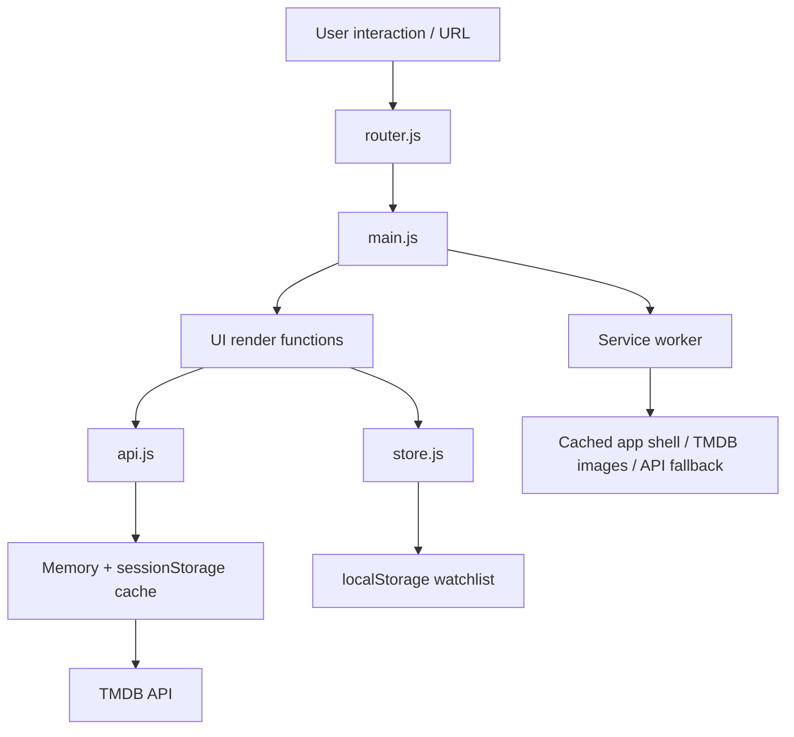

# CineScope

**CineScope** is a cinematic movie-discovery Progressive Web App built with plain HTML, CSS, and JavaScript. It uses TMDB data to help users browse popular films, search titles, explore cast profiles, watch trailers, and save a local watchlist.

No framework, build tool, backend, database, or third-party JavaScript library is used.

## Features

- Browse Trending, Popular, Top Rated, and Upcoming movies.
- Search movies and actors with a 1-second handwritten debounce.
- Cancel stale search requests with `AbortController`.
- Infinite search results using `IntersectionObserver`.
- Filter browse/search results with genre chips.
- Shareable hash routes for movies, cast profiles, search, and watchlist.
- Movie details with cast, runtime, genres, rating ring, and on-demand YouTube trailer dialog.
- Clickable cast profiles with biographies and movie filmographies.
- Persistent, validated `localStorage` watchlist.
- In-memory and `sessionStorage` API cache with a 5-minute TTL.
- Lazy images, keyboard navigation, custom scrollbars, and loading/error/empty states.
- Installable PWA with offline app shell support.

## Screenshots

Capture the final deployed site at desktop and mobile widths, then add images under `docs/screenshots/` using these filenames:

```text
docs/screenshots/home-desktop.png
docs/screenshots/movie-details.png
docs/screenshots/cast-profile-mobile.png
```

Suggested portfolio captures:

1. Home page with a populated movie rail.
2. Movie details page showing cast and action buttons.
3. Mobile cast profile or search page to demonstrate responsive design.

## Tech stack

| Area       | Choice                                                            |
| ---------- | ----------------------------------------------------------------- |
| UI         | Plain HTML, hand-written CSS, native DOM APIs                     |
| JavaScript | ES modules                                                        |
| Movie data | TMDB API v3 endpoints with v4 read-access token                   |
| Routing    | Hash routing                                                      |
| State      | A small `localStorage` store with pub/sub                         |
| Caching    | Memory + `sessionStorage` TTL cache; service-worker Cache Storage |
| PWA        | Web App Manifest + hand-written service worker                    |

## Architecture



The data flow is intentionally one-way:

```text
Route or user event → state/API request → render → DOM event delegation → next state change
```

`api.js` is the only normal application module that calls `fetch`. This keeps authentication, error normalisation, cancellation, and caching in one place. UI modules only create safe DOM nodes with `textContent` and `createElement`; they never inject TMDB strings with `innerHTML`.

## Project structure

```text
.
├── index.html                 # Application shell and CSP
├── styles/main.css            # Responsive cinematic UI
├── js/
│   ├── config.js              # Local TMDB token (ignored by Git)
│   ├── config.example.js      # Safe committed config template
│   ├── api.js                 # TMDB requests and response cache
│   ├── router.js              # Hash route matching
│   ├── store.js               # Watchlist/theme local state and pub/sub
│   ├── utils.js               # Debounce helper
│   ├── main.js                # Bootstrapping and global event delegation
│   └── ui/                    # Home, search, details, person, watchlist views
├── manifest.webmanifest
└── sw.js                      # PWA caching strategies
```

## Run locally

1. Copy `js/config.example.js` to `js/config.js` if it does not already exist.
2. Paste your **TMDB v4 Read Access Token** into `readAccessToken`.
3. Serve the folder with VS Code Live Server or another static server.
4. Visit the local URL. Do not open `index.html` with `file://`; ES modules and service workers require a server context.

## TMDB credential note

CineScope is frontend-only, so its TMDB read token is visible to the browser. This is expected for TMDB public-data applications; it is not a private user-data secret. Follow TMDB’s terms and rate limits.

`js/config.js` is ignored to keep the token out of the repository. For a purely static public deployment, the browser still needs a token at runtime, so the GitHub Pages workflow generates `config.js` from a repository secret at deploy time. Never put credentials for private systems in this project.

## Deploy

### GitHub Pages

Deployment is handled by `.github/workflows/deploy.yml`, which runs on every push to `main`.

1. In **Settings → Secrets and variables → Actions**, add a repository secret named `TMDB_READ_ACCESS_TOKEN` containing your TMDB v4 Read Access Token.
2. In **Settings → Pages**, set **Source** to **GitHub Actions**.
3. Push to `main` (or run the workflow manually from the **Actions** tab).
4. Wait for the workflow to finish, then open the URL shown in Settings → Pages.

### Netlify or Vercel

1. Import the repository.
2. Select a static-site deployment; no build command and no publish-directory override are needed.
3. Ensure `js/config.js` is present in the deployed files.
4. Deploy. Both hosts provide HTTPS, which enables the service worker.

After deploying, open DevTools → Application and verify the manifest and service worker. Update `SHELL_CACHE` in `sw.js` whenever app-shell files change, so users receive fresh assets.

## How to present it in a university evaluation

Use this five-minute demo:

1. Start on Home and point out independently loaded category rows and lazy posters.
2. Search for a film, explaining the 1-second debounce, `AbortController`, and infinite scroll.
3. Open a movie to show hash routing, details, SVG rating ring, cast, and on-demand privacy-friendly trailer.
4. Open a cast member to show the profile and filmography route.
5. Add/remove a film from the watchlist, refresh, and show persistence.
6. In DevTools, show the service worker and explain the three caching strategies.

## Interview questions and strong answers

1. **Why hash routing instead of the History API?**  
   Hash routes work on static hosts without server rewrite rules. The server always returns `index.html`; the browser handles everything after `#`.

2. **Why centralise requests in `api.js`?**  
   It avoids duplicated auth headers and makes cancellation, cache keys, errors, and future API changes consistent across every view.

3. **What does debounce solve?**  
   It waits until typing pauses before searching, reducing unnecessary requests. CineScope waits one second after the latest keystroke.

4. **Why is `AbortController` needed if requests are debounced?**  
   A request can still be slow when a new query begins. Aborting the older request prevents out-of-order results from replacing newer ones.

5. **How does infinite scroll work here?**  
   An `IntersectionObserver` watches a sentinel after the grid. When it nears the viewport, the next TMDB page loads without a costly scroll handler.

6. **How do you protect against XSS from API text?**  
   TMDB values are assigned through `textContent` and elements are built with DOM APIs. `innerHTML` is not used for external data, and the CSP restricts executable sources.

7. **Why validate `localStorage` data?**  
   Browser storage can be edited or corrupted. The store validates IDs, strings, poster paths, dates, ratings, duplicates, and maximum list size before rendering.

8. **Why are there two API caches plus a service worker?**  
   The memory/session cache avoids repeat requests within browsing sessions, while the service worker provides network fallback and offline-friendly resource caching.

9. **Why is the trailer iframe created only on click?**  
   It avoids loading a third-party player for users who never watch it, improves performance and privacy, and uses YouTube’s `youtube-nocookie.com` domain.

10. **What would you add next in a production version?**  
    User accounts for cross-device watchlists, stronger automated tests, image-error recovery, analytics with consent, and a server-side token proxy if the data source required a secret.

## License

Created as a portfolio project. Movie data and images are provided by TMDB; comply with TMDB attribution and terms of use when publishing.
